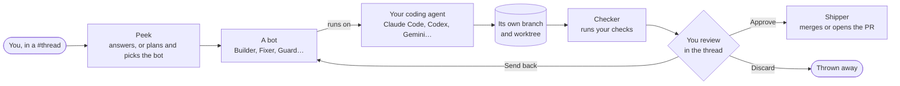

<div align="center">


<h1>Squad Code</h1>

<h3>Slack for your coding bots. Talk to the crew in threads; they do the work.</h3>

<p>
Each project is a workspace, each piece of work is a <b>#thread</b>, and the bots are your teammates.<br />
Say what you want in a sentence. <b>Peek</b>, the crew lead, answers or plans it and hands each job to the right bot.<br />
Bots work on the coding agent you already use (Claude Code, Codex, Gemini and nine more), each job on its own branch,<br />
and you approve, send it back or throw it away right in the thread.
</p>

<p>
<a href="https://github.com/hyperhale/squadcode/releases/latest"></a>
&nbsp;
<a href="#run-from-source"></a>
&nbsp;
<a href="#run-the-crew-on-a-server"></a>
</p>

<p>
<a href="https://github.com/hyperhale/squadcode/actions/workflows/ci.yml"></a>
<a href="https://github.com/hyperhale/squadcode/releases"></a>
<a href="LICENSE"></a>


</p>

<p>
<a href="#how-it-works"><b>How it works</b></a> ·
<a href="#a-tour"><b>Tour</b></a> ·
<a href="#the-crew"><b>The crew</b></a> ·
<a href="#peek-squads-own-intelligence"><b>Peek</b></a> ·
<a href="#make-it-yours"><b>Themes</b></a> ·
<a href="#squad-in-a-terminal"><b>squad CLI</b></a> ·
<a href="#run-the-crew-on-a-server"><b>Server</b></a> ·
<a href="#getting-started"><b>Get started</b></a>
</p>

<br />


</div>

<br />

> [!NOTE]
> **Squad Code 2.0 is in alpha** (`v2.0.0-alpha.7`). Expect rough edges, and please [open an issue](https://github.com/hyperhale/squadcode/issues) when you hit one. See [what's missing](#known-gaps) before you download.

## How it works

If you've used Slack, you already know your way around:

| Slack | Squad Code |
| --- | --- |
| Workspaces down the left edge | **Projects**: one per folder, switched from the rail |
| Channels | **#threads**: one per piece of work, like `#checkout` or `#flaky-tests` |
| Teammates and DMs | **Bots**: Builder, Fixer, Guard and the rest, each one a message away |
| The person who runs the channel | **Peek**, the crew lead, in every thread |



- **Just talk.** Type in a thread the way you'd message a teammate. Peek decides whether to answer, ask back, or turn it into jobs. `@` brings a bot in, `#` points at another thread, and `/` has the rest: `/plan`, `/race`, `/ask`, `/thread`, `/rename`, `/archive`.
- **One job per bot per thread.** Every job belongs to the bot you asked (or the one Peek picked when you didn't name one), and that bot does its own kind of work. Until you approve its job, whatever you say to that bot in that thread goes into the same job, on the same branch. After that, your next ask starts a new one. Each bot also keeps a short notebook of its recent jobs in each project.
- **Plans before work.** For anything bigger than one step, Peek posts a plan card: the steps and the bot for each. Nothing starts until you press its **Start** button.
- **Your checkout is never touched.** Every job that changes files gets its own branch (`squad/<slug>`) and worktree, so several jobs run side by side without stepping on each other.
- **Proven before you look.** When a job finishes, Checker runs the project's checks in its worktree, and the job card shows the result next to the diff.
- **Bring your own agents.** Squad Code drives the agent CLIs you already have installed and signed in. It never sells or proxies tokens, and every bot can run on a different engine and model.
- **Native and light.** Pure Rust on GPUI, with no Electron and no web view. The crew animates at 60 frames a second without getting in the way of the work.

## A tour

### Threads: where the work is talked about


Each thread is a chat with the crew about one piece of work. Your asks and the bots' replies read like a conversation, grouped by who said them, with clock times and reactions. Every job arrives as a live card in the thread: its progress while it runs, then its branch, its change and its checks, with the buttons it needs right there. A job that just finished folds down to a single line once you've dealt with it.

The rail on the far left switches projects, and the sidebar lists the project's threads (with unread counts), a direct message with every bot, and what needs you. The status bar along the bottom shows every engine in play today, how much of its plan is left and what the crew has spent; click it for the day's details and the Usage page.

### A job, with everything about it in one sidebar


Open any job to see what the bot says and does as it happens. The right sidebar has three tabs that share one place: **Details** (time, turns, cost, the plan step by step, and the files it touched while there's no review card listing them), **Jobs** (everything running and waiting in this thread or all of them) and **Git**. The job's **Open** menu has its browser, a terminal and its folder; the terminal opens a real shell in the job's own worktree.

<table>
<tr>
<td width="50%" valign="top">

### Git, in the thread


Every job card shows its branch, its commits and how far its base has moved ("squad/apple-pay · 3 commits · 2 behind main"). The Git tab shows your branch against GitHub, every branch the crew is working on, and the watch-outs to sort out before approving.

</td>
<td width="50%" valign="top">

### Seatbelt and clash ahead


Before Shipper pushes or a job is merged, the **seatbelt** checks the change for secrets, key files and leftover clash markers, and holds it with a card that says what and where. Every 45 seconds Squad test-merges the crew's work in the same project, and when two jobs change the same lines, Peek warns you on both, before either is approved.

</td>
</tr>
</table>

### A browser the bots can drive, live inside Squad


Each job gets its own headless browser, and its bot drives it with Squad's browser tools: open, look, click, type, screenshot, run JavaScript. Pages are read as a short numbered outline, and each step reports only what changed plus the page's errors, so testing a page costs a few hundred tokens instead of a screenshot every time. Click **Browser** on a job to watch the page live and click, scroll or type into it yourself. `localhost` links in a job's messages open here too. Every engine gets it, through Squad's MCP server or the `squad browser` commands.

<table>
<tr>
<td width="50%" valign="top">

### Race it


Try one job on two or three engines at once (`/race`), each on its own branch, and compare them side by side: time, cost, size of change and checks. Keep the one you like; Shipper takes it from there and the others are thrown away.

</td>
<td width="50%" valign="top">

### Plans


Something too big for one job? Peek splits it into two to six jobs, each for the right bot. Remove a step, move it up or hand it to another bot, then start it: the jobs run one after another, each building on the last.

</td>
</tr>
<tr>
<td width="50%" valign="top">

### Needs you


Everything waiting on you, in one two-pane list: finished work to review, bots waiting on your yes, and jobs that stopped. A job that ends badly says what went wrong in plain words, with the one or two things that get it going again.

</td>
<td width="50%" valign="top">

### Direct messages


Every bot is a DM away. Ask about the code in plain words: the bot reads the folder and answers, and nothing changes unless you start a job. Each bot keeps its own conversation.

</td>
</tr>
</table>

## The crew


Every bot is a line-drawn face in its own colour, and its face follows what it's doing: listening, thinking, working, done, stuck or waiting on you.

| Bot | What it does | Kind of job |
| --- | --- | --- |
| **Peek** | Leads every crew. Answers questions, plans bigger work, hands each job to the right bot, and offers a bot your crew is missing. Always there. | Ask, plan |
| **Builder** | Writes the code: plans briefly, makes the change with tests, keeps to the project's style. | Build |
| **Fixer** | Hunts the bug: paste an error or describe it, and it finds the cause and fixes it. | Fix |
| **Guard** | Keeps your rules: reviews changes for risks to login, payments and data before they land. | Review |
| **Checker** | Tries it for real: runs the tests or drives the app in its browser, and runs the checks on every finished job. | Test |
| **Keeper** | Tidies up: dependencies, flaky tests, dead code, the chores nobody gets to. | Tidy |
| **Explainer** | Reads the code and answers in plain words. | Ask |
| **Shipper** | Owns git: squashes a job's commits, opens the pull request, watches its checks and merges when you've asked it to. | Ships what the others made |

**Make your own** with **Add a bot**: give it a name, a role, its skills and tools, and an engine. Each bot's **Setup** picks the engine and model it runs on, the skills it uses and the apps it may connect to.

### Engines: any bot on any agent


An **engine** is one of the coding agents Squad Code drives and the model it runs on. Each bot can have its own (Builder on Claude Code, Guard on Codex, say) and the rest follow the default. Squad Code detects which agent CLIs are installed and reads their models from the CLI itself, so new releases show up without an update.

| Engine | Command | | Engine | Command |
| --- | --- | --- | --- | --- |
| Claude Code | `claude` | | Copilot | `copilot` |
| Codex | `codex` | | Amp | `amp` |
| Gemini | `gemini` | | Droid | `droid` |
| OpenCode | `opencode` | | Qwen Code | `qwen` |
| Cursor | `cursor-agent` | | Grok | `grok` |
| Antigravity | `agy` | | Pi | `pi` |

See [provider setup](docs/providers.md) for installing and signing in to each one.

## Peek: Squad's own intelligence

Peek reads every message you send with your own engine (Claude Code, Codex, Grok and the others, on your own plan) and decides: reply, ask back, plan, stop what's running, run the app, answer a question about the project, or hand the work to the bot whose role fits. When your engine can't be reached, Peek says so and starts nothing. Claude Code is kept warm in the background, so a message reads in about two seconds. When you come back to a thread, Peek posts a short catch-up of only what you missed.

Squad Code still decides some things for itself: whether a job runs here or on your server (and why, in the job's feed), when to suggest a bot you keep needing, and what Peek says. **Smart Peek**, if you turn it on, writes card titles and recaps with a small model on your computer. Turn it on in **Settings → Engines**, or with `squad brain install`.

## Make it yours

<table>
<tr>
<td width="50%"></td>
<td width="50%"></td>
</tr>
</table>

**Settings → Appearance** has eight themes, each with a live preview: **Crew Chat** (the default), **Midnight**, **Graphite**, **Deep sea** and **Daylight**, which are solid, and **Frost**, **Mist** and **Aurora**, frosted glass that lets your desktop show through the window. Pick a **background image** (six ship with the app, or use your own) and tune its blur, dim and how far it shows through. A see-through window and see-through popovers have their own sliders.


**Settings → Appearance → Mascot** sets how the crew is drawn: line weight, colour (crew colour, pastel, two-tone or rainbow) and eyes, and dresses each bot with a role kit, with a large live preview in every mood.


## The project file

Put a `squad.toml` at the top of a repository (`squad project init` writes one from what Squad finds) and every job sets up the same way. Every key is optional.

```toml
setup = ["pnpm install"]            # run in each job's fresh worktree first
copy = [".env.local"]               # ignored files each worktree gets a copy of
run = "pnpm dev --port $PORT"       # how to start the app
url = "http://localhost:$PORT"
port = 3100                         # each job's app gets its own port from here
checks = ["pnpm lint", "pnpm test"] # what Checker runs
```

**Run app** starts what `run` says. With no `squad.toml`, Squad works it out from the project: a `dev`, `start`, `serve` or `preview` script in `package.json` (with pnpm, yarn or bun when their lockfile is there), `deno task`, `cargo run`, Django's `manage.py`, a Python `app.py` or `main.py` (FastAPI under uvicorn, Streamlit, Flask; through uv, Poetry or the project's `.venv` when it has one), `go run .`, Flutter, Rails, Laravel, Phoenix, Rack, Spring Boot with Maven or Gradle, `dotnet run`, Hugo, Jekyll, a Procfile's `web:` line, a `dev`, `run`, `serve` or `start` target in a Makefile or justfile, Docker Compose, a Dockerfile, PHP, and last a plain `index.html` served as files. When it can't tell, Run app opens Setup on the Overview so you can say.

## Squad in a terminal

Every job you can start in the window you can start from a terminal, including the one built into each job. `squad` is installed for you in `~/.squadcode/bin`.

```bash
squad do make the checkout remember the cart   # Peek picks the bot
squad fix the login redirect loops on Safari   # a Fix job, for Fixer
squad new --bot Guard look for leaked keys     # a job for one bot
squad ls                                       # jobs, newest first
squad show 12                                  # where #12 stands and what it changed
squad approve 12                               # or: squad discard 12, squad stop 12
squad brain why tidy up the old feature flags  # where Peek would send a job, and why
```

<details>
<summary><b>Every command</b></summary>
<br />

| Command | What it does |
| --- | --- |
| `squad ls` | Jobs, newest first |
| `squad show <id>` | One job: where it stands and what it changed |
| `squad new <words…>` | A Build job in this folder |
| `squad fix\|test\|tidy\|review <words…>` | A job of that kind |
| `squad new --bot <name> <words…>` | A job for one bot |
| `squad do <words…>` | Your engine picks the bot |
| `squad approve <id>` / `discard <id>` / `stop <id>` | Approve a job waiting for review, throw its changes away, or stop it |
| `squad later [<when> <words…>\|cancel <id>]` | Start a job later (tonight, 2am, in 2h, tomorrow at 7am), or list and cancel waiting ones |
| `squad rewind <id> [n]` | Put a job back to before your message n |
| `squad issue <ref>` / `squad linear key <key>` | Read a GitHub or Linear issue, or save a Linear key |
| `squad lessons [forget <bot> <n>]` | What the bots learned from your reviews here |
| `squad project [init]` | Show this project's `squad.toml`, or write a starting one |
| `squad serve [--listen <address>\|tailscale]` | Run the crew here with no window ([below](#run-the-crew-on-a-server)) |
| `squad pair [name]` / `devices` / `unpair <name>` | Pair a device with the server, list them, or cut one off |
| `squad brain why <words…>` | Where Peek would send a job, and why |
| `squad brain ideas` | A bot Peek thinks you could use |
| `squad brain install [file]` / `remove` | Turn Smart Peek on with Squad's own model, or off and delete it |

Jobs run in the Squad Code app while it's open, or in `squad serve`.

</details>

## Run the crew on a server

`squad serve` runs the same crew with no window, on a VPS or any machine that stays on, so jobs keep going while your laptop is shut.

```bash
squad serve                      # listens on 127.0.0.1:7640 and prints a pairing code
squad serve --listen tailscale   # or listen on this machine's Tailscale address
squad pair laptop                # a one-time code for another device
```

- **Nothing is opened to the internet.** It listens on `127.0.0.1:7640` unless told otherwise; reach it over an SSH tunnel or Tailscale.
- **Every device pairs.** `squad pair` prints a one-time code (8 characters, 10 minutes, 5 tries) that a device trades for its own token, and `squad unpair` revokes one.
- **One API for every client.** A small HTTP API under `/v1/` covers state, jobs and their actions, chats, goals, folders and devices, and `GET /v1/events` streams every change as server-sent events, so a job started from one device shows up live on all of them. `squad new` and the other commands on the server feed the same crew.
- **Peek knows where work belongs.** When you have a server, Peek decides per job whether it runs here or there, by where the project lives, where the agent is signed in and how long the work is, and says why in the job's feed.

Connecting the desktop app and the phone to a server is coming next; today you drive a server with `squad` on it or through the API.

## Getting started

### Download

Builds are on the [Releases](https://github.com/hyperhale/squadcode/releases) page:

| Platform | File |
| --- | --- |
| Mac (Apple silicon) | `SquadCode-<version>-macos-arm64.dmg` or `.zip` |
| Linux x86_64 and arm64 | `.deb` or `.tar.gz` |
| Windows x86_64 | `.zip` |

Open the disk image and drag **Squad Code** to Applications. Squad Code checks for newer versions and offers to download them; nothing installs on its own.

### Known gaps

> [!WARNING]
> - **The Mac app is signed ad hoc, not notarized.** The first time, right-click **Squad Code** in Applications and choose **Open**.
> - **No Intel Mac build yet.** The bundled `llama-server` doesn't link on x86_64 macOS yet. Intel Macs can [build from source](#run-from-source).
> - **Smart Peek's model has no public download yet**, and the Mac build doesn't bundle `llama-server` yet. The built-in classifier and rules work without it; to try Smart Peek now, point `squad brain install <file.gguf>` at a model you have, or use one you serve with llama-server or Ollama.
> - **The desktop app can't connect to `squad serve` yet.** See [Run the crew on a server](#run-the-crew-on-a-server).

### First run


A two-step welcome checks which coding agents are installed and asks for a folder; both steps can be skipped. The folder becomes your first project, with a `#general` thread and Peek ready to talk. Until there's work, the page shows what to do first.

### Requirements

- macOS on Apple silicon (Linux and Windows builds are made too, but macOS is the primary platform)
- `git`
- At least one agent CLI from [the table above](#engines-any-bot-on-any-agent), installed and signed in
- Optional: the [GitHub CLI](https://cli.github.com) (`gh`), for Shipper's pull requests
- To build from source: a recent stable [Rust toolchain](https://rustup.rs) (pinned in `rust-toolchain.toml`)

### Run from source

```bash
git clone https://github.com/hyperhale/squadcode
cd squadcode
cargo run -p squadcode --release
```

Set `SQUADCODE_DEMO=1` to open the app on a made-up crew with threads and jobs in every state, without running anything or saving anything. That's how the screenshots in this README were taken.

### Build the app

To build `Squad Code.app` and a disk image with its icon, use [cargo-bundle](https://github.com/burtonageo/cargo-bundle):

```bash
cargo install cargo-bundle
cd native/squad-app && cargo bundle --release
```

On Linux the same command makes a `.deb`, and on Windows the icon is built into `SquadCode.exe`. To publish a release, see [docs/releasing.md](docs/releasing.md).

### Where Squad Code keeps its data

Everything lives in `~/.squadcode`: the crew's folders, jobs and chats in `v2.json`, settings in `settings.json`, logs and crash reports in `logs/`, and the `squad` command in `bin/`. The first time Squad Code opens it copies what Runo had saved in `~/.runo`. Set `SQUADCODE_HOME` to move it all.

## Learn more

- 🔌 **[Provider setup](docs/providers.md)**: installing and signing in to each engine.
- 🧠 **[Training Squad's own model](training/README.md)**: the test sets, data and scripts behind Smart Peek.
- 📝 **[Changelog](CHANGELOG.md)**: everything that changed, as it lands.
- 🚀 **[Releasing](docs/releasing.md)**: how a release is built and signed.

## Contributing

Contributions are welcome. See [CONTRIBUTING.md](CONTRIBUTING.md) to get set up, and [SECURITY.md](SECURITY.md) to report a vulnerability privately.

## License

[MIT](LICENSE)

<br />

<div align="center">

<br />
<sub>Built in Rust for people who'd rather hand out the jobs than juggle the agents.</sub>
</div>
