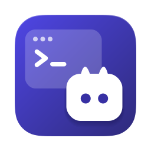
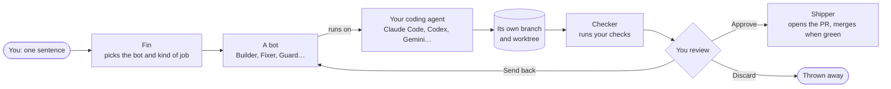
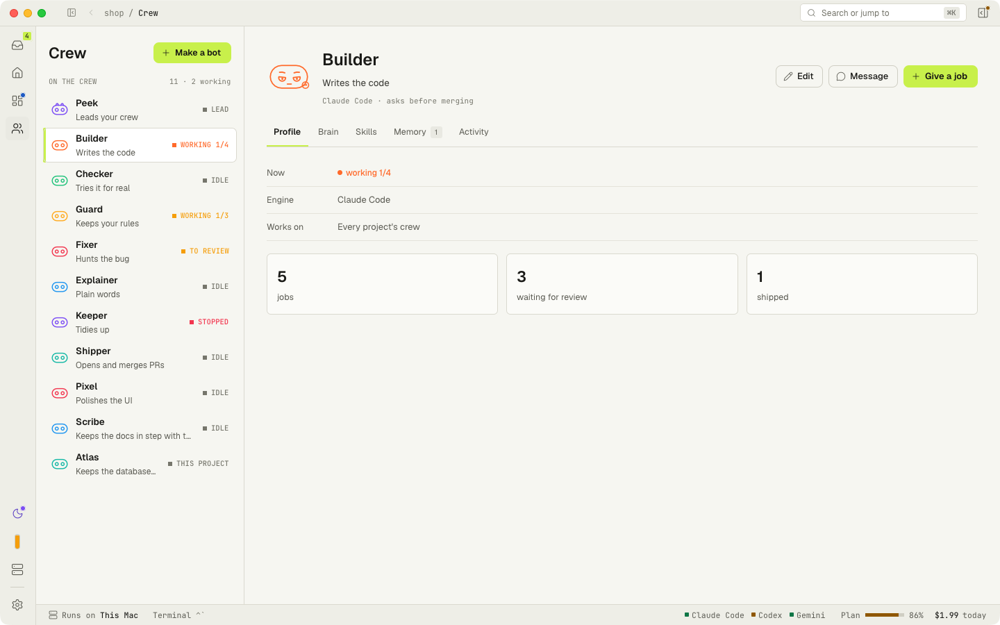
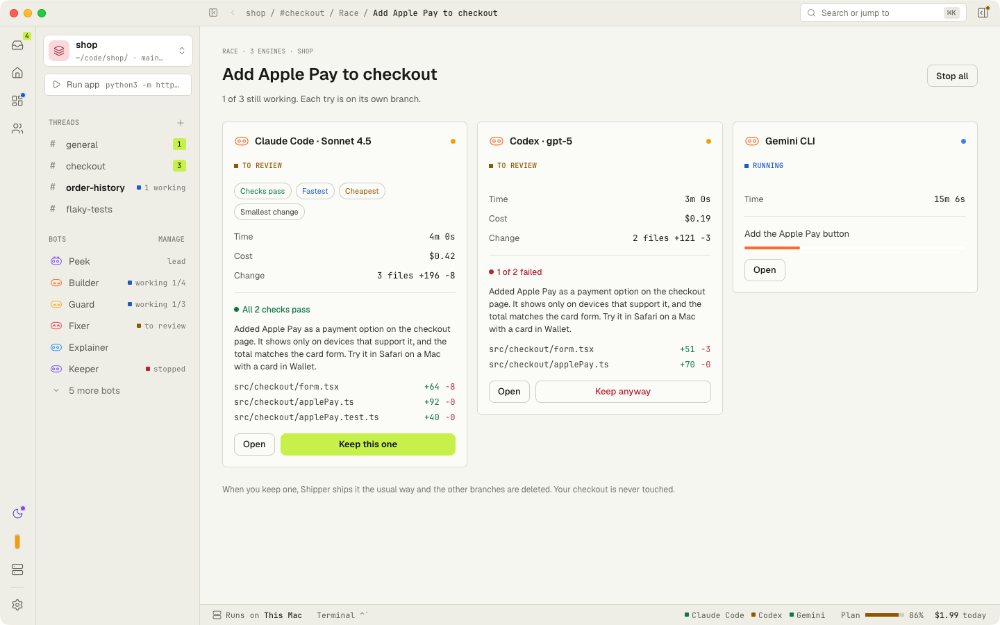
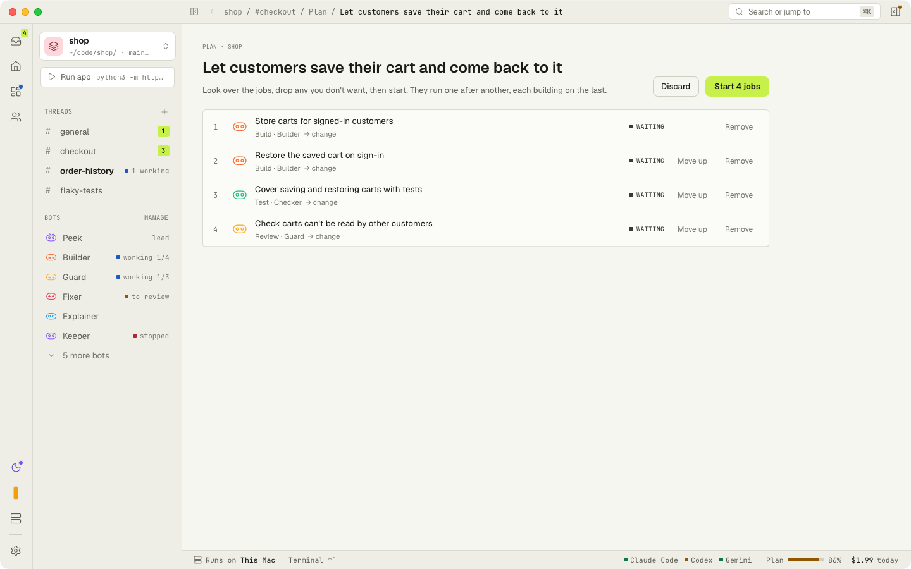
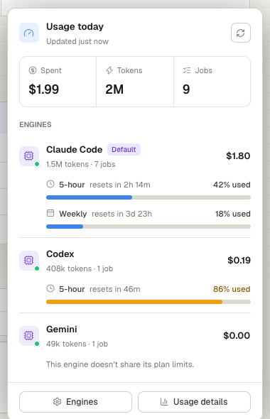
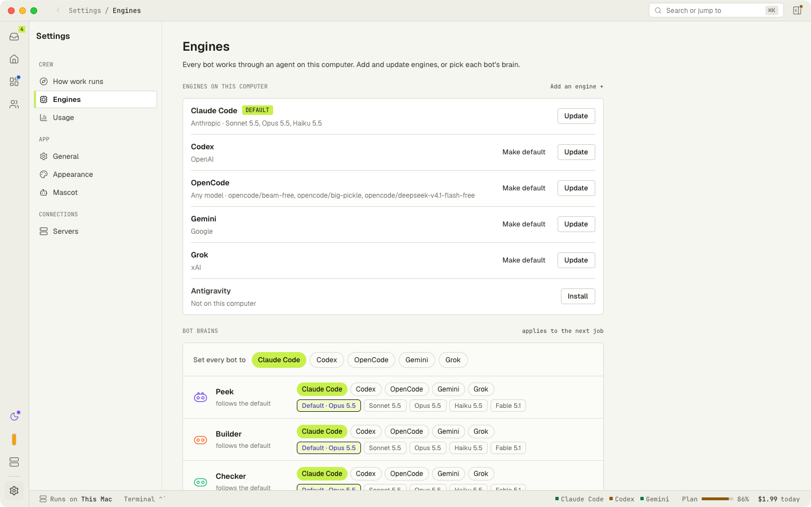
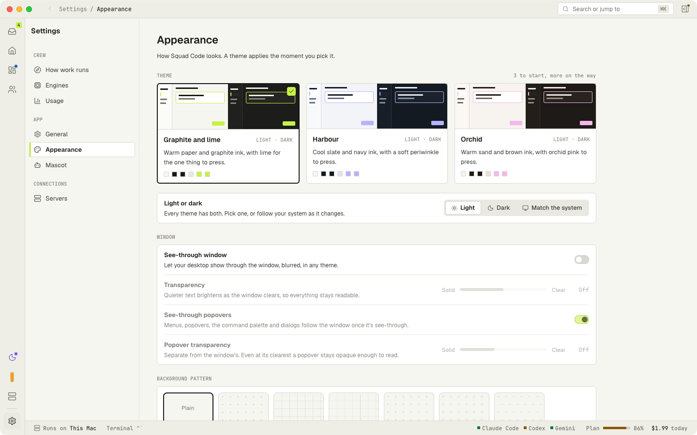
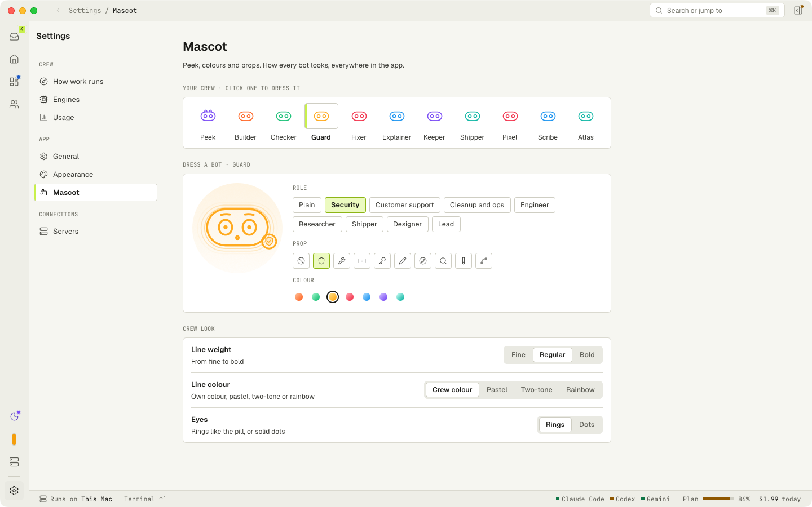
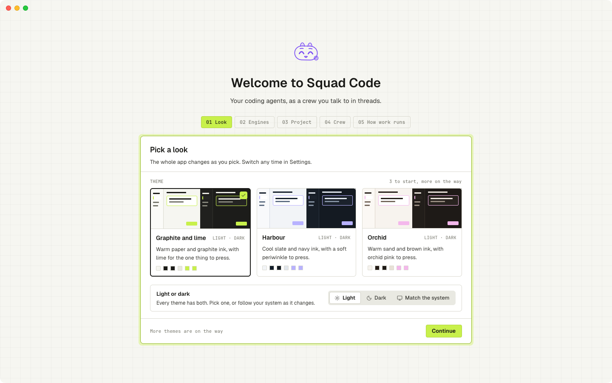

<div align="center">



<h1>Squad Code</h1>

<h3>A crew of coding bots, led by Fin. You hand out the jobs.</h3>

<p>
Type what you want in a sentence. <b>Fin</b> picks the right bot, the bot does the work on the coding agent you already use<br />
(Claude Code, Codex, Gemini and nine more), each job on its own branch, and <b>Checker</b> runs your checks before you see it.<br />
You approve, send it back or throw it away. <b>Shipper</b> opens the pull request.
</p>

<p>
<a href="https://github.com/hyperhale/squadcode/releases/latest"></a>
&nbsp;
<a href="#run-from-source"></a>
&nbsp;
<a href="#run-the-crew-on-a-server"></a>
</p>

<p>
<a href="https://github.com/hyperhale/squadcode/actions/workflows/ci.yml"></a>
<a href="https://github.com/hyperhale/squadcode/releases"></a>
<a href="LICENSE"></a>


</p>

<p>
<a href="#how-it-works"><b>How it works</b></a> ·
<a href="#the-crew"><b>The crew</b></a> ·
<a href="#a-tour"><b>Tour</b></a> ·
<a href="#fin-squads-own-intelligence"><b>Smart Fin</b></a> ·
<a href="#themes"><b>Themes</b></a> ·
<a href="#squad-in-a-terminal"><b>squad CLI</b></a> ·
<a href="#run-the-crew-on-a-server"><b>Server</b></a> ·
<a href="#getting-started"><b>Get started</b></a>
</p>

<br />


</div>

<br />

> [!NOTE]
> **Squad Code 2.0 is in alpha** (`v2.0.0-alpha.6`). It's the app that used to be called Runo, rebuilt around a crew of bots. Expect rough edges, and please [open an issue](https://github.com/hyperhale/squadcode/issues) when you hit one. See [what's missing](#known-gaps) before you download.

## How it works



- **One box for every job.** Pick **Ask**, **Build**, **Fix**, **Review**, **Test** or **Tidy**, or just type and let Fin decide. **Split** turns something big into a goal of a few jobs; **Race** tries one job on two or three engines at once.
- **Your checkout is never touched.** A job that may change files gets its own branch (`squad/<slug>`) and worktree, so several jobs run side by side without stepping on each other.
- **Proven before you look.** When a job finishes, Checker runs the project's checks in its worktree and the review shows the result next to the diff.
- **Bring your own agents.** Squad Code drives the agent CLIs you already have installed and signed in. It never sells or proxies tokens, and every bot can run on a different engine and model.
- **Native and light.** Pure Rust on GPUI, with no Electron and no web view. The crew is drawn at 60 frames a second without getting in the way of the work.

## The crew



Every bot is drawn as **Fin**, the hex-headed mascot, in its own colour and dressed for its job.

| Bot | What it does | Kind of job |
| --- | --- | --- |
| **Fin** | Leads every crew. Answers questions about the code, hands each job to the right bot, and offers a bot your crew is missing. Always there, can't be removed. | Ask |
| **Builder** | Writes the code: plans briefly, makes the change with tests, keeps to the project's style. | Build |
| **Fixer** | Hunts the bug: paste an error or describe it, and it finds the cause and fixes it. | Fix |
| **Guard** | Keeps your rules: reviews changes for risks to login, payments and data before they land. | Review |
| **Checker** | Tries it for real: runs the tests or a flow and tells you what broke, and runs the checks on every finished job. | Test |
| **Keeper** | Tidies up: dependencies, flaky tests, dead code, the chores nobody gets to. | Tidy |
| **Explainer** | Reads the code and answers in plain words. | Ask |
| **Shipper** | Owns git: squashes a job's commits, opens the pull request, watches its checks and merges when you've asked it to. | Ships what the others made |

**New crews start with Fin alone.** When a job comes in that nobody on the crew does, Fin holds it and asks: add the bot it suggests and start, make your own bot for it, or not now. Goals add the bots their plan needs when you start them. **Make your own** on the Crew page builds a bot from Fin's parts: colour, role kit, head, fins and chest props, with **Surprise me**.

## A tour

### Watch a job as it works


Open any job to see what the bot says and does as it happens, with its plan step by step, the files it touched and what it has cost. A terminal drawer at the bottom opens a real shell in the job's own worktree, so you can run, test or poke at the branch without touching your checkout.

<table>
<tr>
<td width="50%" valign="top">

### Review and ship


When a job finishes you see what changed and Checker's proof. **Approve** merges it into the branch it started from, or, in a project on GitHub, has Shipper push it and open a pull request written from the job. **Send back** with a few more words, or **Discard**.

</td>
<td width="50%" valign="top">

### Race it



Try one job on two or three engines at once, each on its own branch, and compare them side by side. Keep the try you like best; Shipper takes it from there and the others are thrown away.

</td>
</tr>
<tr>
<td width="50%" valign="top">

### Goals



Something too big for one job? **Split** it. Squad Code turns the goal into two to six jobs, each for the right bot. Drop what you don't want and start it: the jobs run one after another, each building on the last.

</td>
<td width="50%" valign="top">

### Chat with any bot


Ask any bot about the code in plain words. It reads the folder and answers, and nothing changes. Each bot keeps its own conversation.

</td>
</tr>
<tr>
<td width="50%" valign="top">

### Needs you


Everything waiting on you in one two-pane list: finished work you haven't looked at and jobs that stopped. A job that ends badly says what went wrong in plain words, with the one or two things that get it going again, like another engine when one runs out of plan.

</td>
<td width="50%" valign="top">

### Usage



Spend, jobs, success rate and time at work over the last 30 days, per day and per bot. The status bar along the bottom shows every engine in play today with how much of its plan is left; click it for the details.

</td>
</tr>
</table>

### Engines: any bot on any agent



An **engine** is one of the coding agents Squad Code drives and the model it runs on. Each bot can have its own (Builder on Claude Code, Guard on Codex, say) and the rest follow the default. Squad Code detects which agent CLIs are installed and reads their models from the CLI itself, so new releases show up without an update.

| Engine | Command | | Engine | Command |
| --- | --- | --- | --- | --- |
| Claude Code | `claude` | | Copilot | `copilot` |
| Codex | `codex` | | Amp | `amp` |
| Gemini | `gemini` | | Droid | `droid` |
| OpenCode | `opencode` | | Qwen Code | `qwen` |
| Cursor | `cursor-agent` | | Grok | `grok` |
| Antigravity | `agy` | | Pi | `pi` |

See [provider setup](docs/providers.md) for installing and signing in to each one.

## Fin: Squad's own intelligence

Peek reads every message you send with your own engine (Claude Code, Codex, Grok and the others, on your own plan) and decides: reply, ask back, stop what's running, run the app, answer a question about the project, or hand the work to the bot whose role fits. There are no keyword rules or built-in classifiers. When your engine can't be reached, Peek says so and starts nothing. Claude Code is kept warm in the background, so a message reads in about two seconds.

Squad Code still decides some things for itself: whether a job runs here or on your server (and why, in the job's feed), when to suggest a bot you keep needing, and what Peek says. Smart Fin, if you turn it on, writes card titles and recaps with a small model on your computer. Turn it on in **Settings → Engines**, or with `squad brain install`.

## Themes

<table>
<tr>
<td width="50%"></td>
<td width="50%"></td>
</tr>
</table>

**Settings → Appearance** has seven themes, each with a live preview: **Midnight** (the original look), **Graphite**, **Deep sea** and **Daylight**, which are solid, and **Frost**, **Mist** and **Aurora**, frosted glass that lets your desktop show through the window, blurred. A theme applies the moment you pick it. **Settings → Mascot** changes Fin's material (liquid glass, bubble glow or solid) and dresses each bot with a role kit, a hat and props, with a live preview in every mood.



## Squad in a terminal

Every job you can start in the window you can start from a terminal, including the one built into each job. `squad` is installed for you in `~/.squadcode/bin`.

```bash
squad do make the checkout remember the cart   # Fin picks the bot and the kind of job
squad fix the login redirect loops on Safari   # a Fix job, for Fixer
squad new --bot Guard look for leaked keys     # a job for one bot
squad ls                                       # jobs, newest first
squad show 12                                  # where #12 stands and what it changed
squad approve 12                               # or: squad discard 12, squad stop 12
squad brain why tidy up the old feature flags  # where Fin would send a job, and why
```

<details>
<summary><b>Every command</b></summary>
<br />

| Command | What it does |
| --- | --- |
| `squad ls` | Jobs, newest first |
| `squad show <id>` | One job: where it stands and what it changed |
| `squad new <words…>` | A Build job in this folder |
| `squad fix\|test\|tidy\|review <words…>` | A job of that kind |
| `squad new --bot <name> <words…>` | A job for one bot |
| `squad do <words…>` | Your engine picks the bot and the kind of job |
| `squad approve <id>` / `discard <id>` / `stop <id>` | Approve a job waiting for review, throw its changes away, or stop it |
| `squad serve [--listen <address>\|tailscale]` | Run the crew here with no window ([below](#run-the-crew-on-a-server)) |
| `squad pair [name]` / `devices` / `unpair <name>` | Pair a device with the server, list them, or cut one off |
| `squad brain why <words…>` | Where Fin would send a job, and why |
| `squad brain ideas` | A bot Fin thinks you could use |
| `squad brain install [file]` / `remove` | Turn Smart Fin on with Squad's own model, or off and delete it |

Jobs run in the Squad Code app while it's open, or in `squad serve`.

</details>

## Run the crew on a server

`squad serve` runs the same crew with no window, on a VPS or any machine that stays on, so jobs keep going while your laptop is shut.

```bash
squad serve                      # listens on 127.0.0.1:7640 and prints a pairing code
squad serve --listen tailscale   # or listen on this machine's Tailscale address
squad pair laptop                # a one-time code for another device
```

- **Nothing is opened to the internet.** It listens on `127.0.0.1:7640` unless told otherwise; reach it over an SSH tunnel or Tailscale.
- **Every device pairs.** `squad pair` prints a one-time code (8 characters, 10 minutes, 5 tries) that a device trades for its own token, and `squad unpair` revokes one.
- **One API for every client.** A small HTTP API under `/v1/` covers state, jobs and their actions, chats, goals, folders and devices, and `GET /v1/events` streams every change as server-sent events, so a job started from one device shows up live on all of them. `squad new` and the other commands on the server feed the same crew.
- **Fin knows where work belongs.** When you have a server, Fin decides per job whether it runs here or there, by where the project lives, where the agent is signed in and how long the work is, and says why in the job's feed.

Connecting the desktop app and the phone to a server is coming next; today you drive a server with `squad` on it or through the API.

## Getting started

### Download

Builds are on the [Releases](https://github.com/hyperhale/squadcode/releases) page:

| Platform | File |
| --- | --- |
| Mac (Apple silicon) | `SquadCode-<version>-macos-arm64.dmg` or `.zip` |
| Linux x86_64 and arm64 | `.deb` or `.tar.gz` |
| Windows x86_64 | `.zip` |

Open the disk image and drag **Squad Code** to Applications. Squad Code checks for newer versions and offers to download them; nothing installs on its own.

### Known gaps

> [!WARNING]
> - **The Mac app is signed ad hoc, not notarized.** The first time, right-click **Squad Code** in Applications and choose **Open**.
> - **No Intel Mac build yet.** The bundled `llama-server` doesn't link on x86_64 macOS yet. Intel Macs can [build from source](#run-from-source).
> - **Smart Fin's model has no public download yet**, and the Mac build doesn't bundle `llama-server` yet. The built-in classifier and rules work without it; to try Smart Fin now, point `squad brain install <file.gguf>` at a model you have, or use one you serve with llama-server or Ollama.
> - **The desktop app can't connect to `squad serve` yet.** See [Run the crew on a server](#run-the-crew-on-a-server).

### First run



A two-step welcome checks which coding agents are installed and asks for a folder; both steps can be skipped. Until there are jobs, the Jobs page shows what to do first: cards to install an agent or pick a folder, **Look around with sample jobs first**, and every kind of work to start from. A short **Get started** checklist in the sidebar points at real controls.

### Requirements

- macOS on Apple silicon (Linux and Windows builds are made too, but macOS is the primary platform)
- `git`
- At least one agent CLI from [the table above](#engines-any-bot-on-any-agent), installed and signed in
- Optional: the [GitHub CLI](https://cli.github.com) (`gh`), for Shipper's pull requests
- To build from source: a recent stable [Rust toolchain](https://rustup.rs) (pinned in `rust-toolchain.toml`)

### Run from source

```bash
git clone https://github.com/hyperhale/squadcode
cd squadcode
cargo run -p runo --release
```

Set `RUNO_V2_DEMO=1` to open the app on a made-up crew with jobs in every state, without running anything or saving anything.

### Build the app

To build `Squad Code.app` and a disk image with its icon, use [cargo-bundle](https://github.com/burtonageo/cargo-bundle):

```bash
cargo install cargo-bundle
cd native/runo-app && cargo bundle --release
```

On Linux the same command makes a `.deb`, and on Windows the icon is built into `SquadCode.exe`. To publish a release, see [docs/releasing.md](docs/releasing.md).

### Where Squad Code keeps its data

Everything lives in `~/.squadcode`: the crew's folders, jobs and chats in `v2.json`, settings in `settings.json`, logs and crash reports in `logs/`, and the `squad` command in `bin/`. The first time Squad Code opens it copies what Runo had saved in `~/.runo`. Set `SQUADCODE_HOME` to move it all.

## The classic window

Squad Code grew out of Runo, a session-by-session app for running coding agents, with a Design canvas, Architecture diagrams, a Git place, Cove VMs, playbooks and a phone bridge. That window is still in the code for development (`RUNO_V1=1`), and its [guide](docs/guide) describes it, but the crew is the app now and those parts are being brought over one at a time.

## Learn more

- 🔌 **[Provider setup](docs/providers.md)**: installing and signing in to each engine.
- 🧠 **[Training Squad's own model](training/README.md)**: the test sets, data and scripts behind Smart Fin.
- 📝 **[Changelog](CHANGELOG.md)**: everything that changed, as it lands.
- 🚀 **[Releasing](docs/releasing.md)**: how a release is built and signed.

## Contributing

Contributions are welcome. See [CONTRIBUTING.md](CONTRIBUTING.md) to get set up, and [SECURITY.md](SECURITY.md) to report a vulnerability privately.

## License

[MIT](LICENSE)

<br />

<div align="center">

<br />
<sub>Built in Rust for people who'd rather hand out the jobs than juggle the agents.</sub>
</div>
